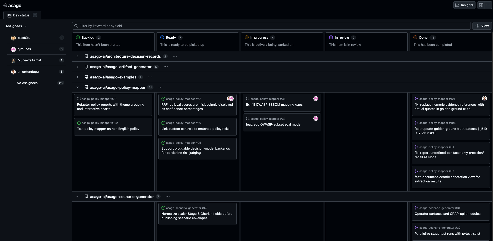

<!-- _class: title -->

# Asago *Tech Recap*

Quick update on our recent work.

---

<!-- _class: pipeline sources compact -->

## Asago Server *ADR 0002: Reporting*

[ADR 0002](https://github.com/asago-ai/architecture-decision-records/pull/2) proposes a component-aware **Report Generator** through the Asago Server. The draft remains open for review.

  

    
Payload envelopes

    <ul>
      <li>Policy Mapper</li>
      <li>Scenario Generator</li>
      <li>Artifact Generator</li>
    </ul>
  

  
→

  

    
Component handlers

    <ul>
      <li>interpret each payload</li>
      <li>validate schema versions</li>
    </ul>
  

  
→

  

    
Report content

    <ul>
      <li>sections · tables · metrics</li>
    </ul>
  

  
→

  

    
Renderers

    <ul>
      <li>HTML · PatternFly</li>
      <li>PDF</li>
      <li>Markdown</li>
    </ul>
  

- A separate **versioned Python package**, not report-generation logic inside each component.
- **Standalone or combined reports**: the caller supplies the outputs and declares their order, without verified
  derivation.
- **Stateless**: the generator retains no request data or reports. The caller owns orchestration and storage.

---

<!-- _class: image sources -->

## A public *project board*

Track work across Asago repositories in one place. The board is public: anyone can see the status of its items.

<a href="https://github.com/orgs/asago-ai/projects/1">https://github.com/orgs/asago-ai/projects/1</a>

---

<!-- _class: callout sources compact -->

## Policy Mapper · *golden ground truth* dataset

We expanded the dataset from **1,519 to 2,211 risks** across **27 policy documents**. [Merged PR #108](https://github.com/asago-ai/asago-policy-mapper/pull/108)

| Metric    | Before | After      |
|-----------|--------|------------|
| Precision | 52.69% | **80.54%** |
| Recall    | 81.75% | **83.31%** |
| F1        | 64.08% | **81.90%** |

Reported scores before and after the ground-truth update, not a controlled comparison of mapper versions.

- Dataset generation used **2-of-3 model agreement**, symmetric validation, and an LLM judge.
- PR [#108](https://github.com/asago-ai/asago-policy-mapper/pull/108) reports higher F1 for all 27 documents and **637 fewer false positives** under the updated ground truth.
- Follow-up fix in [PR #121](https://github.com/asago-ai/asago-policy-mapper/pull/121) restored evidence quotes and added missing risk names in 271 risks across 23 files.

---

<!-- _class: callout sources -->

## Getting started: *Guardrails Recommender*

The [Guardrails Recommender](https://github.com/asago-ai/asago-guardrails-recommender) repository started this week.
These two open feature requests define the initial scope, not completed features:

- ### [FR #4](https://github.com/asago-ai/asago-guardrails-recommender/issues/4) · NeMo Guardrails output

  Produce a **complete, deployable NeMo configuration** from attack artifacts and benign counterparts, without the
  manual merge step.
  Include version metadata and in-process evaluation. Cluster deployment remains outside scope.

- ### [FR #5](https://github.com/asago-ai/asago-guardrails-recommender/issues/5) · Decision Model policies

  A **second output type**: generate policy documents for LLM-based judges, as a separate process from the NeMo rail
  recommender.

> Both issues are open for comments. Share feedback on the inputs, outputs, and scope.

---

<!-- _class: stats sources -->

## Automated *dependency updates*

Dependabot activity across the asago repositories:

- **25**
  updates merged

- **92%**
  automatically merged (23 of 25)

- **3**
  repositories covered

- **20**
  distinct dependencies, including GitHub Actions

---

<!-- _class: cards credits teal -->

## Get *involved*

- ### Follow along

  Follow the [project board](https://github.com/orgs/asago-ai/projects/1) for work across Asago repositories.

- ### Join the conversation

  Open a topic in [Discussions](https://github.com/asago-ai/community/discussions) — questions and ideas are welcome.

- ### Contribute

  If you understand English and another language, test a non-English policy against the English IBM Risk Atlas taxonomy.
  [Issue #122](https://github.com/asago-ai/asago-policy-mapper/issues/122)

- ### Review the ADR

  Comment on [ADR 0002](https://github.com/asago-ai/architecture-decision-records/pull/2) — output-format selection and
  HTML templates remain open.
  Review feedback also covers links between outputs and offline HTML.
