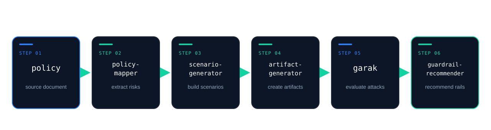

<!-- _class: title -->

# Asago *Tech Recap*

Updates since the last tech meeting.

---

<!-- _class: callout sources compact -->

## Guardrails Recommender *v1*

The first implementation of the final Asago pipeline stage is now available.

- Takes attack artifacts and recommends a minimal set of NeMo Guardrails rails.
- Builds a NeMo configuration and tests it through NeMo's `/v1/checks`.
- Includes a catalog of **65 rails**, examples for **2 use cases**, and **16 offline tests**.
- The examples cover **195 scenarios** and **28 attacks**.

[Initial implementation · PR #6](https://github.com/asago-ai/asago-guardrails-recommender/pull/6) · [Repository and demo](https://github.com/asago-ai/asago-guardrails-recommender)

---

<!-- _class: callout sources compact -->

## Next step · *OpenShell policy recommender*

Building on the Guardrails Recommender, [Issue #12](https://github.com/asago-ai/asago-guardrails-recommender/issues/12) defines the initial scope for an OpenShell policy recommender.

- Generate an OpenShell policy for an agent scenario, with **network**, **filesystem**, and **secrets-management** controls.
- Demonstrate that filesystem controls block a prompt-injection attempt to read unrelated files.

---

<!-- _class: image -->

## End-to-end demo · *in progress*

---

<!-- _class: stats sources compact -->

## Policy Mapper · *decision models for speed*

External contribution from **Janam Patel** (NC State University). [Issue #95](https://github.com/asago-ai/asago-policy-mapper/issues/95)

The work explores faster borderline-risk judging and candidate filtering before grounding.

- **~1 hour**
  saved per 14-hour run with the hosted Jev filter (14.1–14.4 h → 13.1 h).

- **~25×**
  faster judge stage. Replacing only the judge had little effect on total runtime.

> Macro F1 stayed within the baseline range, with a small recall drop. Further validation remains open.

---

<!-- _class: cards credits teal -->

## Help shape the *next iteration*

- ### Try the recommender

  Explore the sample results and share feedback on the [Guardrails Recommender](https://github.com/asago-ai/asago-guardrails-recommender).

- ### Review the reporting ADR

  Comment on [ADR 0002](https://github.com/asago-ai/architecture-decision-records/pull/2), which remains open.

- ### Discuss the next output

  Share feedback on [FR #5](https://github.com/asago-ai/asago-guardrails-recommender/issues/5) for Decision Model policy generation.

- ### Shape OpenShell support

  Review the proposed scope for the [OpenShell policy recommender](https://github.com/asago-ai/asago-guardrails-recommender/issues/12).
